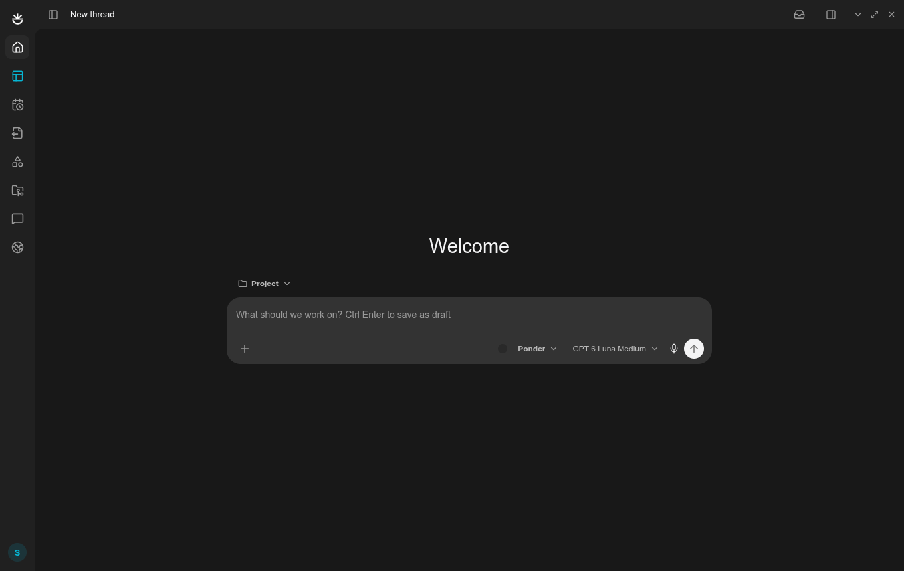

<div align="center">
  <h1>OpenPond</h1>
  <p><strong>Post-train models and measure what improved.</strong></p>
</div>

OpenPond is an open-source, local-first workspace for model training and
benchmarking. Build datasets and graders, compare model versions on the same
benchmark, and post-train a base model with a reviewed recipe. Start in Desktop
or use the CLI to inspect and reproduce the workflow.

## From benchmark to trained model

1. **Build a Dataset and Grader.** Import examples or author tasks from selected
   work. Review what the model can see, validate the grader on known examples,
   and keep training and held-out evaluation splits separate.
2. **Run a Benchmark.** Measure the baseline, then compare a candidate on the
   same Dataset revision, graders, and evaluation protocol. Inspect individual
   results and retain the exact inputs for another run.
3. **Post-train a Model.** Start with a compatible base model and choose supervised
   fine-tuning with LoRA or reinforcement learning with GRPO. Review the inputs,
   recipe, compute, and budget before starting on a supported local or managed
   target.
4. **Evaluate the saved version.** Re-run the held-out Benchmark and compare the
   evidence before selecting a version to use or serve.



In Desktop, use **+ New** to start a Model, Benchmark, Dataset, or Grader
draft. The draft opens in chat, and **Configure** opens its setup form.
Local authoring and supported local benchmarks can use your configured model
provider. OpenPond Managed runs use a signed-in workspace.

## Installation

```bash
npm install -g openpond
openpond
```

### Run without Installation

```bash
npx openpond@latest # Start local Node server and web UI

npx openpond tui         # Terminal UI
npx openpond serve       # Headless API server
npx openpond ui --no-open # Web server without opening a browser
```
Requires Node.js 24.18 or newer.

### Desktop app

Install the latest version from [GitHub Releases](https://github.com/openpond/openpond/releases).

> [!NOTE]
> package managers coming soon

Conversations and settings persist under `~/.openpond`

### Install via git

```bash
git clone https://github.com/openpond/openpond.git
cd openpond

corepack enable # Enable the pnpm version pinned by this repository
pnpm install --frozen-lockfile
pnpm dev # Server & Desktop App
pnpm dev:web # Server & Web
```

Corepack makes the repository's pinned `pnpm@11.13.0` available when running
from source. If you already have that version of pnpm, skip `corepack enable`.

## Training and benchmarking from the CLI

With the local app server running, list saved Models and Benchmarks from a
terminal.

```bash
openpond training projects --json
openpond experiments list --local --json
```

Learn how to prepare evidence, review recipes, and evaluate saved models in the
[training guide](docs/public/training.md). See the [CLI guide](docs/public/cli.md)
for preparation, execution, and result inspection, and the
[portable training guide](docs/public/portable-training.md) for compute options.

## npm packages

OpenPond publishes five packages to npm. Internal application and workspace
packages are implementation details and are documented in the
[development guide](docs/public/development.md).

| Package | Role |
| --- | --- |
| [`openpond`](https://www.npmjs.com/package/openpond) | CLI, TUI, Local OpenPond app, and bundled app-server executable. |
| [`openpond-agent-sdk`](https://www.npmjs.com/package/openpond-agent-sdk) | TypeScript SDK and CLI for authoring, validating, evaluating, and packaging deployable OpenPond Agents. |
| [`openpond-sdk`](https://www.npmjs.com/package/openpond-sdk) | Server-side TypeScript SDK for hosted Work and sandboxes. |
| [`@openpond/harness`](https://www.npmjs.com/package/@openpond/harness) | Portable immutable Harness releases, workspaces, improvements, tools, models, and Refiner contracts. |
| [`@openpond/evals`](https://www.npmjs.com/package/@openpond/evals) | Portable Tasksets, graders, evaluation runs, receipts, conformance, and Work evidence. |

Harness is the dependency base for Evals: `@openpond/evals` depends on
`@openpond/harness`, applications import both packages directly, and Harness
never imports Evals.

## Refine the harness

The Refiner turns a completed turn into a bounded, reviewable improvement decision. It examines only the evidence you provide, then either returns no action, proposes a targeted change to an available Harness layer, or routes an issue to its actual owner. Proposed changes receive a separate model critique and deterministic admission checks before a host can apply them.

Use the provider-neutral Refiner from @openpond/harness with your own model stream and authorized evidence packet:

~~~ts
import { authorLocalHarnessRefinementWithModel } from "@openpond/harness";

const decision = await authorLocalHarnessRefinementWithModel({
  evidence, // bounded observations, turn history, sources, and capabilities
  stream: ({ messages, signal }) => provider.stream({ messages, signal }),
  signal: new AbortController().signal,
});

if (decision.decision === "propose") {
  // Present the proposal for host validation and review before applying it.
  console.log(decision.route, decision.summary);
}
~~~

The Refiner never treats a prompt keyword, an error string, or a fixed recurrence count as authority to change the Harness. See the [@openpond/harness README](packages/harness/README.md) for the evidence contract, decision schema, and verification command.

Refiner behavior can be extended with a separately versioned JSON Review Profile. Invoke `$openpond-refiner-authoring <change>` in Work to inspect and update it through the bundled Skill, or use `@openpond/harness/refiner` directly. Settings exposes the active Refiner Core and Review Profile, immutable release history, validation receipts, activation, and rollback.

## Use the SDK with an API key

Use [openpond-sdk](https://www.npmjs.com/package/openpond-sdk) from a Node.js server, worker, or Next.js route handler to run hosted Work and manage sandboxes directly. Create an OpenPond API key, keep it in server-side configuration, and never expose it in browser code or a NEXT_PUBLIC_* variable.

~~~bash
npm install openpond-sdk
export OPENPOND_API_KEY="opk_..."
~~~

~~~ts
import { createOpenPondClient } from "openpond-sdk";

const openpond = createOpenPondClient({
  apiKey: process.env.OPENPOND_API_KEY!,
});

const result = await openpond.work.run({
  prompt: "Review this repository and summarize the highest-priority issues.",
  cleanup: "delete",
  discardOutputs: true,
});

console.log(result.text);
~~~

work.run creates a sandbox when you do not supply one. For files you want to keep, provide persistOutput instead of discardOutputs; for direct sandbox lifecycle and command access, use openpond.sandboxes. The [SDK README](packages/sdk/README.md) includes complete Work, output-persistence, workflow, and raw-sandbox examples.

## Agent workspace

Use the same agent workspace from Desktop, Web, CLI, or TUI. OpenPond keeps
conversations, tool calls, files, and results together with the project. Teams
can share agents and use hosted sandboxes through the [SDK](packages/sdk/README.md).

## Contributions

Contributions are not currently being accepted. Potential contributors will be reviewed on an ongoing basis. This policy helps ensure code quality and keeps AI-assisted contributions aligned with the project's direction and standards.

## License

OpenPond is available under the [MIT License](LICENSE).
