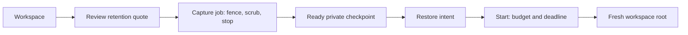

# Filesystem checkpoints

A filesystem checkpoint saves a private stopped workspace. Restoring it prepares a replacement root; a separate **Start** accepts the new compute budget and deadline. An ordinary Start resumes the existing root.

- Capture pauses workspace changes, scrubs managed runtime credentials and stops the source before saving.
- Capture returns a job. Wait for its saved snapshot and `checkpoint.phase: "ready"` before restoring.
- Reserved disk capacity determines the retention quote. Measured snapshot bytes and filesystem checksum may remain `null`.
- Retention, the original root disk and new compute have separate charges and lifetimes. Stop does not imply deletion of retained data.
- Support depends on the source's accepted capabilities. An unavailable offer cannot authorize capture.



## Quote and capture

The existing billing endpoint discovers accepted terms and quotes the requested retention. Reading it reserves no funds. Capture rechecks the terms, owner, wallet and limits.

```ts
import { OpenPondClient } from "openpond-sdk";

const client = new OpenPondClient({ apiKey: process.env.OPENPOND_API_KEY! });
const sandboxId = process.env.SANDBOX_ID!;
const { billing } = await client.sandboxes.billing(sandboxId, {
  snapshotRetentionClass: "cached",
  snapshotRetentionTtlSeconds: 3600,
});
const offer = billing.snapshotRetentionOffer;
if (!offer?.available || !offer.quote) {
  throw new Error("No accepted checkpoint quote is available");
}

const result = await client.sandboxes.createSnapshot(sandboxId, {
  name: "workspace-checkpoint",
  async: true,
  replay: { retention: {
    class: offer.quote.retentionClass,
    ttlSeconds: offer.quote.ttlSeconds,
  } },
  retentionFunding: {
    termsSha256: offer.termsSha256,
    maxUsd: offer.quote.quotedUsd,
  },
});
console.log(result.snapshotJob.id, result.snapshotJob.status);
```

Illustrative result: `snapshot_job_id running`. This acknowledges the job, not a completed checkpoint. Read `client.sandboxes.get(sandboxId)` for its `snapshotJobs` and `snapshots`; failures and pending capture remain distinct from readiness.

```sh
openpond sandbox billing "$SANDBOX_ID" --retention-class cached --retention-ttl-seconds 3600
openpond sandbox snapshot-create "$SANDBOX_ID" --name workspace-checkpoint --async \
  --retention-class cached --retention-ttl-seconds 3600 \
  --retention-terms-sha256 "$ACCEPTED_TERMS_SHA256" --retention-max-usd "$QUOTED_USD"
openpond sandbox get "$SANDBOX_ID"
```

Native checkpoints accept finite retention rather than template publishing or cache-cleaning options. A descriptor hash identifies the saved provider descriptor; it is not a filesystem content hash.

## Prepare restore, then Start

Use a ready, unexpired checkpoint from the same source. The source must already be positively stopped. The returned intent does not allocate new compute or start the workspace. **The separate restore Start deletes the existing stopped root before creating its replacement. Changes made after the checkpoint are lost.** `replaceStoppedRoot: true` acknowledges that replacement; the retained checkpoint keeps its own expiry and charges.

```ts
import { randomUUID } from "node:crypto";

const source = await client.sandboxes.get(sandboxId);
const snapshot = source.snapshots.find((item) => item.id === result.snapshotJob.snapshotId);
if (!snapshot?.checkpoint || snapshot.checkpoint.phase !== "ready") {
  throw new Error("Wait for the checkpoint to become ready");
}
const operationId = randomUUID(); // Save this identity for retries.
const prepared = await client.sandboxes.restore(sandboxId, {
  operationId,
  checkpointId: snapshot.id,
  checkpointCustodyId: snapshot.checkpoint.custodyId,
  expectedSourceUpdatedAt: source.updatedAt,
  replaceStoppedRoot: true,
});
if (!prepared.restoreIntent) throw new Error("Restore intent was not returned");

// Review and persist these values before Start; retry the same acceptance.
const accepted = {
  operationId,
  intentSha256: prepared.restoreIntent.intentSha256,
  maximumUsd: "0.100000",
  executionUntil: new Date(Date.now() + 60_000).toISOString(),
};
const started = await client.sandboxes.start(sandboxId, { restore: accepted });
console.log(started.sandbox.id, started.sandbox.state);
```

Illustrative result: `sandbox_id running`. Start may still be preparing the workspace; inspect its state and run evidence. Read `billing.snapshotRetention` for retained-storage charges, held and released funds, expiry and settlement. The source's compute limits still apply; a larger amount or deadline is rejected.

```sh
openpond sandbox restore "$SANDBOX_ID" --operation-id "$OPERATION_ID" \
  --snapshot-id "$SNAPSHOT_ID" --checkpoint-custody-id "$CUSTODY_ID" \
  --expected-source-updated-at "$SOURCE_UPDATED_AT" --replace-stopped-root
openpond sandbox start "$SANDBOX_ID" --operation-id "$OPERATION_ID" \
  --restore-intent-sha256 "$INTENT_SHA256" \
  --maximum-usd 0.100000 --execution-until "$ACCEPTED_DEADLINE"
```

Keep the operation identity, intent hash, accepted amount and absolute deadline when retrying. An uncertain response does not permit a second capture, an extended deadline or a different payer. A plain `openpond sandbox start` carries no replacement approval.

## Sources

- [CLI commands and authentication](cli.md)
- [Shared configuration and account context](configuration.md)
- [Public sandbox request and result contracts](../../packages/cloud/src/sandbox/types/snapshots.ts)
- [Public billing contracts](../../packages/cloud/src/sandbox/types/billing.ts)
